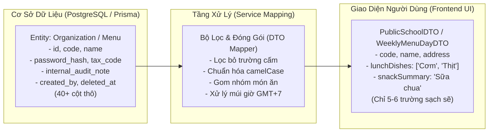
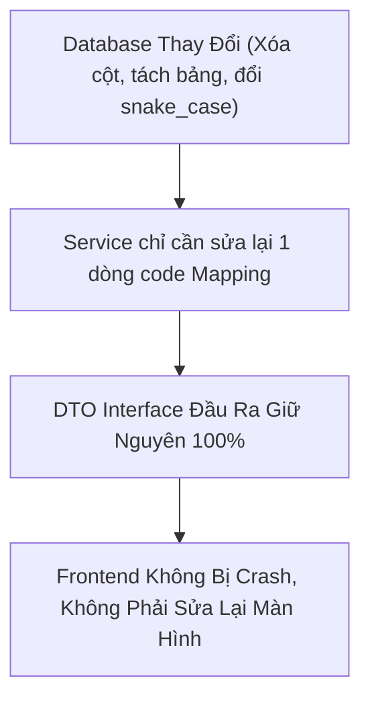
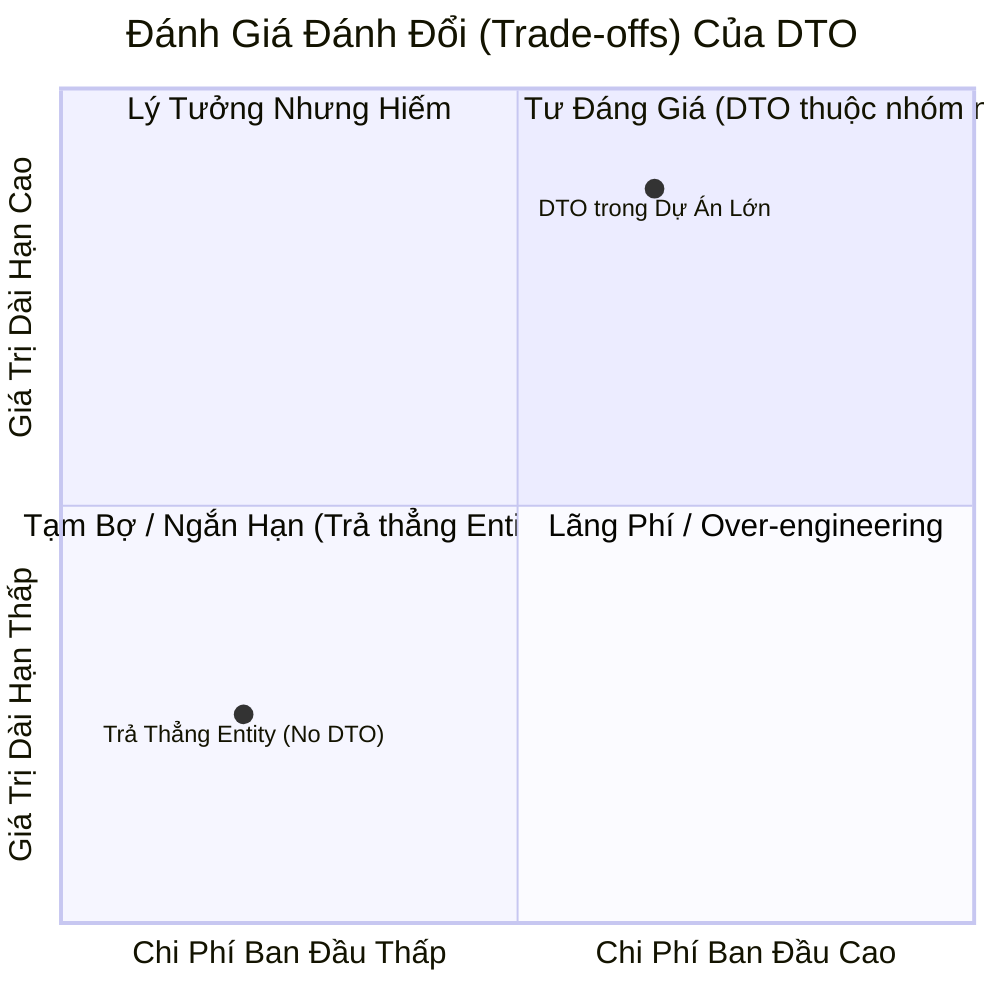

# DTO (Data Transfer Object) - Cẩm Nang Bản Chất & Bộ Áo Giáp Phản Biện Trước Hội Đồng

> **Tài liệu chuẩn bị bảo vệ đồ án / phản biện kỹ thuật dự án FoodPrint.**  
> Mục tiêu tài liệu:
> 1. Giúp bạn thấu suốt bản chất cốt lõi của DTO thông qua các ví dụ đời thực và thực tế dự án FoodPrint.
> 2. Cung cấp **Bộ kịch bản hỏi - đáp phản biện (Q&A Defense Playbook)** với các câu hỏi hóc búa nhất mà Hội đồng / Giảng viên / Tech Lead thường chất vấn về DTO, kèm câu trả lời đanh thép, chuẩn kiến trúc phần mềm.

---

## 1. Bản Chất DTO Là Gì? (Hiểu Bằng Hình Ảnh Đời Thực)

### 1.1. Ẩn dụ đời thực: "Kho Lưu Trữ Gốc" vs "Phiếu Thực Đơn Cho Phụ Huynh"
Để hiểu DTO trong 10 giây, hãy tưởng tượng hệ thống Bếp ăn Bán trú FoodPrint ngoài đời thực:
- **Cơ sở dữ liệu (Database Entity):** Là **Kho tổng & Phòng kế toán của nhà trường**. Nơi đây lưu trữ mọi thứ: hồ sơ cá nhân của hiệu trưởng, giá nhập nguyên liệu từ nhà cung cấp, mật khẩu phần mềm, mã số thuế, lương nhân viên, biên bản kiểm tra nội bộ.
- **DTO (Data Transfer Object):** Là **Tờ Phiếu Thực Đơn phát cho Phụ huynh học sinh** dán ở bảng tin trường hoặc gửi qua Zalo.
  - Tờ phiếu này chỉ in: *Hôm nay ăn món gì, gồm nguyên liệu chính nào, giờ ăn lúc mấy giờ, do ai giám sát.*
  - Tờ phiếu này **TUYỆT ĐỐI KHÔNG IN**: *Giá vốn nhập mớ rau bao nhiêu tiền, mật khẩu két sắt nhà bếp, mã số thuế của hiệu trưởng, hay ghi chú nội bộ của kế toán.*

👉 **Nếu KHÔNG có DTO:** Giống như việc phụ huynh hỏi *"Hôm nay con tôi ăn gì?"*, bạn lại **bê nguyên tập hồ sơ gốc của phòng kế toán đưa cho phụ huynh đọc**. Phụ huynh vừa bị rối mắt vì quá nhiều thông tin thừa, vừa làm lộ bí mật kinh doanh và dữ liệu nhạy cảm của nhà trường.  
👉 **Khi CÓ DTO:** DTO chính là tờ phiếu được gọt giũa sạch sẽ, đúng người đúng việc, an toàn 100%.



---

### 1.2. Định nghĩa kỹ thuật chuẩn mực
- **DTO (Data Transfer Object)** là một **Design Pattern** kinh điển trong công nghệ phần mềm (được Martin Fowler chuẩn hóa).
- **Tính chất cốt lõi:**
  1. **Thuần dữ liệu (Plain Object):** Trong TypeScript, DTO chỉ là các `interface` hoặc `type`. Nó không có phương thức (method), không có hàm tính toán, không chứa logic nghiệp vụ.
  2. **Phi trạng thái (Stateless):** Chỉ mang vác dữ liệu từ điểm A đến điểm B qua ranh giới mạng hoặc giữa các tầng Controller ⟷ Service.
  3. **Không phụ thuộc ORM:** DTO hoàn toàn độc lập với Prisma, TypeORM hay Mongoose.

---

## 2. Tại Sao Bắt Buộc Phải Dùng DTO Trong Hệ Thống FoodPrint?

Hội đồng thường nhìn vào codebase và hỏi: *"Tại sao phải viết thêm file DTO cho mất công?"*. Đây là **4 lý do sống còn** bạn cần nắm vững:

### 2.1. Bảo vệ trước 2 lỗ hổng an ninh mạng kinh điển
1. **Lỗ hổng Over-posting / Mass Assignment (Tự phong quyền):**  
   Khi người dùng đăng ký tài khoản hoặc gửi form, nếu ta nhận thẳng `req.body` đưa vào `prisma.user.create({ data: req.body })`:  
   Kẻ gian có thể mở Postman và chèn thêm trường:
   ```json
   {
     "email": "hacker@gmail.com",
     "password": "123",
     "role": "SYSTEM_ADMIN",      // <-- Tự phong làm Quản trị viên cấp cao
     "isVerified": true           // <-- Tự vượt qua bước xác thực email
   }
   ```
   **Nhờ Input DTO (`RegisterDTO`):** Ta chỉ định nghĩa nhận đúng `email` và `password`. Mọi trường lạ gửi lên sẽ bị trình Validator chặn đứng ngay tại cửa Controller.

2. **Lỗ hổng rò rỉ dữ liệu nhạy cảm (Data Exposure / Leaks):**  
   Trong bảng `users` hoặc `organizations`, cơ sở dữ liệu luôn lưu các trường: `password_hash`, `salt`, `twoFactorSecret`, `deleted_at`. Nếu trả thẳng Entity ra ngoài qua `res.json(user)`, toàn bộ thông tin này sẽ hiển thị ở Network Tab của trình duyệt. **Response DTO đảm bảo các trường này vĩnh viễn không bao giờ lọt ra ngoài Internet.**

---

### 2.2. "Bộ giảm xóc" bảo vệ Frontend khi Database thay đổi (Loose Coupling)
Trong quá trình phát triển dự án thực tế, cấu trúc Database thay đổi liên tục:
- Hôm nay: Bảng `organizations` có cột `addressLine`.
- Ngày mai: Tối ưu chuẩn hóa DB, ta bỏ `addressLine`, chỉ dùng cột `address`, hoặc tách thành bảng `organization_profiles`.



👉 **Nếu không có DTO:** Mỗi lần DB đổi tên cột, team Frontend sẽ phải đi tìm và sửa lại hàng chục component giao diện.  
👉 **Khi có DTO:** Backend đóng vai trò bộ chuyển đổi (Adapter). DB đổi thế nào thì Service chỉ cần map lại đúng các trường của DTO đó, **giao diện Frontend hoàn toàn nguyên vẹn, không tốn 1 giây sửa chữa**.

---

### 2.3. Tối ưu tải trọng mạng (Network Payload) gấp 10 - 20 lần
- Hãy xét API Lấy thực đơn cả tuần cho học sinh (`getWeeklyMenu`):
  - Dưới Database: Bảng `DailyMenu`, `MealItem`, `Recipe`, `Ingredient` có hàng trăm trường (ID khóa ngoại, định lượng chi tiết, đơn vị tính, thời gian tạo, người phê duyệt,...). Dung lượng JSON thô có thể lên tới **2MB - 3MB**.
  - Phụ huynh chỉ cần xem: Tên thứ, danh sách món trưa, món xế.
- Thông qua `WeeklyMenuDayDTO`, dữ liệu được cô đọng lại chỉ còn **20KB - 30KB**.  
👉 **Giảm 95% băng thông**, giúp ứng dụng load tức thì ngay cả khi phụ huynh dùng mạng 4G/3G chập chờn trước cổng trường.

---

### 2.4. Hợp đồng làm việc song song giữa Frontend và Backend (Contract-First)
Trong dự án FoodPrint:
- Ngay từ ngày đầu tiên khi thống nhất tính năng, 2 bên chỉ cần chốt file `public-menu.dto.ts`.
- **Frontend dev:** Dựa vào DTO để dựng giao diện, mock dữ liệu, hoàn thiện component mà không cần đợi Backend viết xong code.
- **Backend dev:** Dựa vào DTO để viết câu truy vấn Prisma và hàm mapping trả về đúng format.  
👉 Giảm thiểu 100% các cuộc tranh cãi: *"Sao ông đặt tên trường là `school_id` mà tôi viết giao diện là `schoolId`?"*.

---

## 3. Có Cách Nào Khác Ngoài DTO Không? (So Sánh Các Giải Pháp)

Hội đồng có thể hỏi: *"Ngoài DTO ra, em có biết các giải pháp khác không? Tại sao em không dùng chúng?"*. Dưới đây là câu trả lời toàn diện:

| Giải pháp | Cách thức hoạt động | Ưu điểm | Nhược điểm | Vì sao FoodPrint chọn DTO thay vì giải pháp này? |
| :--- | :--- | :--- | :--- | :--- |
| **1. Trả thẳng Entity (Active Record)** | Lấy từ DB sao trả ra ngoài y như vậy (`res.json(entity)`). | Viết code cực nhanh, hợp với dự án nhỏ/MVP 1-2 người. | Rất dễ lộ dữ liệu nhạy cảm, dính lỗi Over-posting, DB đổi là FE hỏng. | **Loại bỏ ngay** vì FoodPrint là hệ thống trường học, đòi hỏi bảo mật và phân quyền nghiêm ngặt giữa nhiều vai trò. |
| **2. Prisma `select` / Utility Types** | Dùng `Prisma.validator` hoặc `Prisma.GetPayload` tự sinh type từ câu lệnh `select`. | Type-safe, không phải viết interface thủ công (DRY). | Gắn chặt vào ORM Prisma. Khó xử lý các trường tính toán (computed fields) hoặc format ngày tháng/ghép mảng. | Prisma `select` chỉ lọc cột dưới DB, không thể gộp danh sách món ăn thành mảng string `lunchDishes: ['Cơm', 'Thịt']` như DTO. |
| **3. Schema Inference (Zod / Yup)** | Định nghĩa schema bằng Zod, dùng `z.infer<typeof Schema>` để sinh ra type. | Vừa validate runtime vừa có static type compile-time. | Rất tốt cho **Input DTO** (nhận request), nhưng cồng kềnh nếu dùng cho **Output DTO** (phản hồi API nhiều cấp lồng nhau). | Dự án kết hợp: Dùng validation schema cho đầu vào và interface DTO cho đầu ra. |
| **4. GraphQL** | Client tự viết query đòi các trường cần thiết (`query { school { name } }`). | Không bao giờ thừa/thiếu trường, không cần viết hàng chục REST DTO. | Hạ tầng phức tạp, khó cấu hình cache HTTP/Redis, học liệu cao cho toàn đội ngũ. | Dự án ưu tiên kiến trúc RESTful chuẩn mực, dễ tích hợp với các hệ thống giáo dục bên ngoài. |
| **5. Serializer / Transformer** | Dùng class decorator như `class-transformer` (phổ biến ở NestJS/Java Spring). | Tự động hóa qua annotation `@Exclude()`. | Tốn tài nguyên CPU lúc runtime, cần hệ thống OOP Decorator mạnh (Express thuần không tối ưu bằng). | FoodPrint dùng TypeScript trên Express thuần, DTO Interface nhẹ và nhanh hơn nhiều. |

---

## 4. Bảng So Sánh Ưu & Nhược Điểm Của DTO



### Ưu điểm (Pros):
1. **Bảo mật tuyệt đối:** Lọc bỏ hoàn toàn các trường nhạy cảm (`password_hash`, `salt`, `audit_logs`).
2. **Ngăn chặn Over-posting:** Chặn đứng việc người dùng tự tiêm các trường nguy hiểm (`role: ADMIN`).
3. **Giảm tải băng thông:** Cắt giảm từ 70% đến 95% kích thước payload truyền qua mạng.
4. **Bảo vệ tính toàn vẹn của Frontend:** Database thoải mái nâng cấp mà không sợ làm sập màn hình UI.
5. **Dễ viết Unit Test:** DTO là Plain Object nên cực kỳ dễ tạo mock data kiểm thử độc lập mà không cần kết nối Database thật.

### Nhược điểm (Cons) & Cách Khắc Phục:
1. **Tốn công viết code ban đầu (Boilerplate code):** Phải tạo thêm interface và viết hàm mapping dữ liệu.  
   *Cách khắc phục:* Đây là sự đánh đổi hoàn toàn xứng đáng trong các dự án chuyên nghiệp để đổi lấy sự an toàn và ổn định lâu dài.
2. **Sửa đổi nhiều nơi khi thêm trường mới:** Thêm 1 trường mới từ DB ra ngoài UI cần đi qua 3 bước: Schema DB ➔ Service Mapping ➔ DTO Interface.  
   *Cách khắc phục:* Nhờ TypeScript kiểm tra kiểu tĩnh (Static Type Checking), nếu sửa DTO mà quên sửa Service thì compiler sẽ báo lỗi đỏ ngay lúc build (`npm run typecheck`), không sợ bị sót lỗi runtime.

---

## 5. BỘ KỊCH BẢN PHẢN BIỆN TRƯỚC HỘI ĐỒNG (Q&A Defense Playbook)

Dưới đây là các câu hỏi hóc búa nhất mà các thầy cô trong Hội đồng hoặc Tech Lead thường hỏi khi chấm đồ án:

---

###  Câu Hỏi 1: *"Dự án em dùng Express.js và Prisma ORM. Bản thân Prisma đã có hàm `select: { id: true, name: true }` để lọc trường rồi, tại sao em lại phải bày vẽ viết thêm DTO cho phức tạp và tốn thời gian?"*

> **Gợi ý câu trả lời thuyết phục:**  
> *"Dạ thưa Thầy/Cô, câu hỏi của Thầy/Cô rất chuẩn xác ạ. Prisma `select` quả thực giúp lọc bớt các cột ở câu lệnh SQL, tuy nhiên nhóm quyết định sử dụng DTO vì 3 lý do mà Prisma `select` không thể thay thế được:*
> 1. *Thứ nhất là **các trường tính toán và format (Computed / Derived fields)**: Ví dụ trong thực đơn tuần của FoodPrint, phụ huynh cần danh sách tên các món ăn dạng mảng `lunchDishes: ['Cơm tám', 'Thịt kho trứng', 'Canh rau cải']`. Dưới Database, đây là các bảng quan hệ phức tạp (`Menu` JOIN `Meal` JOIN `Dish`). Prisma `select` chỉ trả về mảng object lồng nhau cồng kềnh, chỉ có tầng Service map qua DTO mới phẳng hóa (flatten) dữ liệu thành mảng string gọn gàng cho Frontend.*
> 2. *Thứ hai là **chuẩn hóa dữ liệu theo nghiệp vụ (Business Formatting)**: Dưới Database lưu múi giờ UTC hoặc số nguyên thô, qua DTO mới được format về giờ Việt Nam `Asia/Ho_Chi_Minh` hoặc gán nhãn trạng thái thân thiện.*
> 3. *Thứ ba là **Tránh phụ thuộc chặt vào ORM (Vendor Lock-in)**: Nếu để Frontend phụ thuộc vào kiểu dữ liệu của Prisma, sau này nếu hệ thống cache dữ liệu bằng Redis hoặc tích hợp API bên ngoài thì Frontend sẽ bị vỡ. DTO là hợp đồng độc lập giúp hệ thống có tính module hóa cao nhất."*

---

###  Câu Hỏi 2: *"Việc phải lấy dữ liệu từ Database lên, sau đó viết hàm map từng trường vào DTO có làm giảm hiệu năng (performance) của server không?"*

> **Gợi ý câu trả lời thuyết phục:**  
> *"Dạ thưa Thầy/Cô, trong kiến trúc máy tính và web hiện đại, chúng ta có 2 loại chi phí: **Chi phí xử lý CPU/RAM trong bộ nhớ** và **Chi phí truyền tải mạng (Network I/O)**.*
> - *Thao tác mapping object trong V8 Engine của Node.js diễn ra ở cấp độ **microsecond (vài phần triệu giây)** trong bộ nhớ RAM, hoàn toàn không gây ảnh hưởng đến hiệu năng.*
> - *Ngược lại, nút thắt cổ chai (bottleneck) lớn nhất của ứng dụng web là **băng thông mạng**. Nhờ DTO lọc bỏ 30 trường thừa, dung lượng gói tin JSON truyền qua Internet giảm từ **2MB xuống chỉ còn 25KB** (giảm gần 99%).*
> - *Vì vậy, xét trên tổng thể, DTO không những không làm chậm hệ thống mà còn giúp hệ thống phản hồi nhanh hơn gấp nhiều lần và tiết kiệm tài nguyên băng thông máy chủ khi có hàng ngàn phụ huynh cùng truy cập vào giờ ăn trưa."*

---

###  Câu Hỏi 3: *"Tại sao nhóm lại đặt DTO ngay trong từng module `src/modules/<feature>/dtos/` mà không gom chung toàn bộ DTO của cả dự án vào 1 thư mục `src/dtos/` ở ngoài cùng?"*

> **Gợi ý câu trả lời thuyết phục:**  
> *"Dạ thưa Thầy/Cô, nhóm áp dụng nguyên lý **Độ kết dính cao, độ phụ thuộc thấp (High Cohesion, Low Coupling)** theo định hướng Module-Package:*
> - *Nếu gom toàn bộ DTO vào `src/dtos/` chung, sau này dự án lớn lên với hàng chục nghiệp vụ, thư mục đó sẽ trở thành một 'thùng rác chứa code' (Junk drawer), rất khó quản lý quyền sở hữu code giữa các thành viên.*
> - *Khi đặt `dtos/` nằm ngang hàng bên trong `src/modules/organization/`, toàn bộ thực thể của module đó (Route, Controller, Service, Validation, DTO) tạo thành một khối độc lập hoàn chỉnh. Khi cần chỉnh sửa nghiệp vụ trường học, lập trình viên chỉ cần thao tác trong đúng 1 thư mục.*
> - *Đặc biệt, cấu trúc này giúp dự án sẵn sàng cho tương lai: Nếu sau này cần tách phân hệ `organization` thành một Microservice riêng biệt, nhóm chỉ việc bê nguyên thư mục module này ra mà không bị vướng phụ thuộc chéo vào phần còn lại của mã nguồn."*

---

###  Câu Hỏi 4: *"Trong dự án FoodPrint của em, hãy chỉ ra 1 ví dụ cụ thể nhất chứng minh: Nếu không có DTO thì hệ thống của em đã gặp lỗi hoặc nguy cơ bảo mật như thế nào?"*

> **Gợi ý câu trả lời thuyết phục:**  
> *"Dạ thưa Thầy/Cô, nhóm có 2 ví dụ thực tế nhất vừa được chuẩn hóa trong đợt phát triển vừa qua:*
> 1. *Ví dụ 1 về **Bảo mật thông tin trường học**: API danh sách trường công khai trên trang chủ (`/schools/public`). Trong bảng `organizations` của cơ sở dữ liệu có chứa mã số thuế, loại hình tổ chức nội bộ, thời gian xóa mềm `deleted_at`. Nếu trả thẳng Entity ra ngoài, bất kỳ ai mở Network Tab cũng soi được toàn bộ cấu hình nội bộ này. Nhờ có `PublicSchoolDTO`, hệ thống chỉ xuất bản đúng 5 trường: `id`, `name`, `code`, `logoUrl`, và `address`.*
> 2. *Ví dụ 2 về **Loại bỏ dữ liệu rác và nghiệp vụ không phù hợp**: Dự án FoodPrint tập trung vào minh bạch nguồn gốc thực phẩm và quản lý suất ăn học đường, **không nằm trong phạm trù dinh dưỡng vi chất**. Trước đây trong codebase bị gán cứng các số liệu ảo về calo, đạm, chất béo (`calories: 680, proteinG: 24, fatG: 18`). Nhờ có DTO, nhóm đã loại bỏ hoàn toàn các trường này khỏi interface `WeeklyMenuDayDTO` và Service, giúp dữ liệu phản hồi trả về sạch sẽ, chuẩn xác và đúng với phạm vi nghiệp vụ được phê duyệt mà không làm xáo trộn cấu trúc lưu trữ của cơ sở dữ liệu."*

---

## 6. Bảng Tóm Tắt Luận Điểm "Bỏ Túi" (Cheat Sheet)

Khi đứng trước hội đồng, chỉ cần ghi nhớ **5 từ khóa cốt lõi**:

1. **PLAIN OBJECT:** DTO chỉ chứa dữ liệu, 0% logic, 0% method.
2. **BẢO MẬT:** Chống lộ password/thông tin nhạy cảm + Chống Over-posting tự phong quyền.
3. **BỘ GIẢM XÓC (BUFFER):** DB thay đổi thoải mái, FE vẫn an toàn không vỡ.
4. **TỐI ƯU PAYLOAD:** Giảm 90% dung lượng JSON qua mạng, app load nhanh trên 4G.
5. **MODULAR DTO:** Đặt trong từng module (`src/modules/<feature>/dtos/`) để đạt chuẩn High Cohesion, sẵn sàng tách Microservices.
