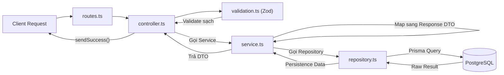

# Hướng Dẫn Quy Chuẩn Phát Triển Backend (Dịch & Chú Giải Chi Tiết AGENTS.md)

> **Bản dịch tiếng Việt chính thức kèm chú giải chi tiết từ tệp `FoodPrintBE/AGENTS.md` (phiên bản cập nhật mới nhất từ `origin/dev`).**  
> Đây là cẩm nang quy chuẩn duy nhất dành cho lập trình viên và AI Assistants khi tham gia xây dựng hệ thống **FoodPrint Backend (`FoodPrintBE`)**.

---

## 1. Cấu Trúc Dự Án & Tổ Chức Module (Project Structure & Module Organization)

Hệ thống FoodPrint Backend sử dụng **TypeScript nghiêm ngặt (Strict TypeScript)**, **Express**, **PostgreSQL**, và **Prisma ORM**.  
Ứng dụng chạy ở chế độ **CommonJS**: tệp `package.json` khai báo `"type": "commonjs"`, TypeScript sử dụng cơ chế phân giải module `Node16` (`node16 module resolution`), và Prisma tạo mã client dạng `cjs`. Đây là hướng dẫn lập trình chuẩn mực duy nhất; giải thích công việc bằng **Tiếng Việt** và chỉ thực hiện các yêu cầu đã được xác nhận.

### 1.1. Cấu trúc thư mục lõi
- `src/app.ts`: Xuất ra hàm khởi tạo ứng dụng Express (`app factory`), hỗ trợ tiêm `rate limiter` phục vụ kiểm thử tự động; `src/server.ts` thực hiện kết nối tới PostgreSQL và Redis trước khi khởi động cổng HTTP.
- `src/config/env.ts`: Nạp các biến môi trường và kiểm tra chuỗi kết nối cơ sở dữ liệu local (`DATABASE_URL`). `src/config/prisma.ts` xuất ra đối tượng Prisma Client dùng chung và hàm trợ giúp kiểm tra kết nối.
- `src/modules/<feature>/`: Tổ chức từng module thành **7 thành phần chuẩn**:
  - `routes` (`<feature>.routes.ts`)
  - `controllers` (`<feature>.controller.ts`)
  - `validation` (`<feature>.validation.ts`)
  - `services` (`<feature>.service.ts`)
  - `repositories` (`<feature>.repository.ts`)
  - `Request DTOs` (`<feature>.request.dto.ts`)
  - `Response DTOs` (`<feature>.response.dto.ts`)  
  > [!IMPORTANT]
  > Mỗi module **bắt buộc phải tách riêng** Request DTOs thành `<feature>.request.dto.ts` và Response DTOs thành `<feature>.response.dto.ts` thành hai tệp độc lập.
  Xem tệp `src/modules/README.md` để nắm quyền sở hữu module và bản đồ endpoint; đăng ký router tập trung tại `src/routes/index.ts`. Mọi endpoint danh sách (`list endpoint`) bắt buộc phải kiểm tra quyền được gán và bộ lọc tổ chức tường minh thông qua `src/utils/resource-access.ts`. Ma trận endpoint đã duyệt và hợp đồng xác thực nằm tại `docs/AUTHORIZATION.md`.
- `src/middlewares/`, `src/constants/`, `src/utils/`, và `src/types/`: Chứa các middleware dùng chung, hằng số vai trò, hàm trợ giúp tiện ích và kiểu dữ liệu request.
- `prisma/schema.prisma`: Mô tả cấu trúc schema đích; `prisma/migrations/` là lịch sử triển khai SQL theo phiên bản, bao gồm cả các ràng buộc `CHECK` chỉ có trên PostgreSQL. `database/SCHEMA_BASELINE.md` ghi nhận nguồn gốc, kết quả kiểm tra catalog, thủ tục tiếp nhận và trạng thái triển khai.  
  > [!WARNING]
  > **Tuyệt đối không ghi đè** các model này từ một cơ sở dữ liệu cũ (legacy). Sử dụng quy tắc đặt tên model/enum dạng `PascalCase`, các trường dùng `camelCase` đi kèm ánh xạ `@map` / `@@map`, và khai báo `@@schema("foodprint")`. Tệp `prisma.config.ts` cung cấp URL cho CLI và đường dẫn migration. Mã client được sinh ra tự động nằm ở `src/generated/prisma/`; mã JavaScript sau khi biên dịch nằm ở `dist/`. **Tuyệt đối không chỉnh sửa thủ công hoặc commit mã được sinh tự động vào git.**

---

## 2. Các Lệnh Build, Test & Phát Triển (Build, Test, and Development Commands)

Chạy các lệnh sau từ thư mục gốc của repo (`FoodPrintBE`) sau khi đã cấu hình tệp `.env` của riêng bạn:

| Lệnh | Ý nghĩa & Mô tả chi tiết |
| :--- | :--- |
| `npm ci` | Cài đặt chính xác các thư viện phụ thuộc theo tệp khóa `package-lock.json`. |
| `npm run prisma:validate` | Kiểm tra tính hợp lệ của cấu trúc `prisma/schema.prisma`. |
| `npm run prisma:generate` | Sinh client TypeScript/CommonJS mà không làm thay đổi cơ sở dữ liệu. |
| `npm run typecheck` | Kiểm tra lỗi kiểu dữ liệu TypeScript của mã nguồn và cấu hình Prisma (`tsc --noEmit`). |
| `npm run dev` | Lắng nghe thay đổi và chạy `src/server.ts` trực tiếp bằng `tsx`. |
| `npm run build` | Sinh Prisma Client và biên dịch ứng dụng sang JavaScript; lệnh `npm start` sẽ chạy `dist/server.js`. |
| `npm run db:check` | Kiểm tra kết nối cơ sở dữ liệu (Azure PostgreSQL hoặc local) bằng Prisma và câu lệnh `SELECT 1`. |
| `npm run db:migrate` | Tạo hoặc áp dụng các migration môi trường phát triển; script sẽ từ chối mục tiêu Azure/remote trước khi gọi Prisma. |
| `npm run db:migrate:create -- --name <mô tả>` | Tạo một bản nháp migration trên PostgreSQL local để review câu lệnh SQL. |
| `npm run db:migrate:deploy` / `npm run db:migrate:status` | Áp dụng các migration đã review lên môi trường chỉ định hoặc kiểm tra lịch sử migration; việc triển khai đòi hỏi ủy quyền nhiệm vụ rõ ràng hoặc qua quy trình dev CD đã phê duyệt. |
| `npm run db:baseline:check` | Đối chiếu DB hiện có với baseline ban đầu (bao gồm các ràng buộc `CHECK`) bằng câu truy vấn catalog chỉ đọc. Lệnh này không bao giờ đánh dấu áp dụng migration. |
| `npm run db:deploy:check` | Kiểm tra lịch sử/mục tiêu Azure (chỉ đọc); yêu cầu `DATABASE_URL` và `AZURE_DATABASE_HOST`, baseline đã tiếp nhận và checksum migration không bị thay đổi. |
| `npm run db:push` | Đẩy trực tiếp thay đổi schema lên PostgreSQL mà không tạo tệp migration. |
| `npm run db:pull` | Tự động đọc cấu trúc (introspect) và cập nhật `prisma/schema.prisma` từ PostgreSQL. |
| `npm run db:studio` | Mở giao diện đồ họa web Prisma Studio để trực quan hóa và quản lý dữ liệu. |
| `docker compose up -d --no-recreate --wait redis` | Khởi động dịch vụ Redis local mà không tạo lại container đang chạy. **Tuyệt đối không dùng `--remove-orphans` hoặc xóa volumes** để giải quyết lỗi cấu hình. |
| `npm run redis:check` | Kiểm tra kết nối Redis local bằng lệnh `PING`. |
| `npm run test:rate-limit` | Chạy test HTTP không phụ thuộc DB bằng Node test runner; `npm run test:rate-limit:redis` kiểm tra Redis Docker local với tiền tố test cách ly. |
| `npm run test:cache` | Kiểm tra hàm trợ giúp cache dùng chung không cần hạ tầng; `npm run test:cache:redis` kiểm tra với Redis local bằng các key test cách ly. |
| `npm run test:modules` | Kiểm tra phân quyền danh sách nghiệp vụ, phân trang, safe projections, serialization và xử lý lỗi không cần DB hoặc Redis. |
| `npm run test:unit` | Chạy toàn bộ test không phụ thuộc hạ tầng, bao gồm role middleware; bổ sung các file test unit mới vào script này khi được tạo thêm. |
| `npm run test:authorization` | Chạy test đăng nhập, quyền hạn, cách ly tenant và concurrency của admin trên cơ sở dữ liệu mới tạo riêng biệt trên local PostgreSQL tạm thời. |
| `npm run auth:bootstrap` | Khởi tạo danh mục quyền đã duyệt trên local PostgreSQL; cờ `-- --azure` là hành động tường minh của operator yêu cầu `AZURE_DATABASE_HOST` và các migration đã áp dụng đầy đủ. Quy trình CD không bao giờ seed. Không tài khoản hoặc mock data nào được tạo; các quyền của role phi-System và cờ inactive được giữ nguyên. |
| `npm run test:migrations` | Kiểm tra tiếp nhận baseline và SQL migration trên một DB PostgreSQL tạm dùng một lần chỉ định bởi `MIGRATION_TEST_DATABASE_URL`; **tuyệt đối không dùng Azure hoặc DB của thành viên khác**. |
| `npm run lint` / `npm run lint:fix` | Kiểm tra chất lượng code hoặc tự động sửa các lỗi ESLint cho phép. |
| `npm run format:check` / `npm run format` | Kiểm tra định dạng hoặc tự động format code bằng Prettier cho các tệp hỗ trợ. |
| `npm run validate` | Chạy theo thứ tự: `lint` ➔ `format:check` ➔ `typecheck` ➔ `build`; dừng lại ngay ở lỗi đầu tiên. |

---

## 3. Phong Cách Lập Trình & Kiến Trúc (Coding Style & Architecture)

- **Quy chuẩn định dạng:** Sử dụng **2 dấu cách thụt dòng**, **dấu ngoặc kép (`"`)**, **dấu chấm phẩy (`;`)**, hàm và biến đặt tên dạng `camelCase`, kiểu dữ liệu dạng `PascalCase`, và hằng số vai trò viết `HOA_TOÀN_BỘ`.
- **Prettier & ESLint:** Prettier quản lý định dạng; ESLint kiểm tra chất lượng code và đã vô hiệu hóa các quy tắc định dạng xung đột. Không reformat toàn bộ kho mã nguồn nếu không thuộc phạm vi thay đổi.
- **Import trong TypeScript:** Import đường dẫn tương đối trong môi trường CommonJS hiện tại không dùng đuôi mở rộng (extensionless); giữ nguyên đuôi `.js` ở các import tương đối thuộc dạng ESM.
- **Quy tắc đặt tên tệp trong module:**
  - `<feature>.routes.ts`
  - `<feature>.controller.ts`
  - `<feature>.validation.ts`
  - `<feature>.service.ts`
  - `<feature>.repository.ts`
  - `<feature>.request.dto.ts`
  - `<feature>.response.dto.ts`

### 3.1. Phân định trách nhiệm của 7 thành phần trong Module:

1. **Controllers (`<feature>.controller.ts`):**  
   - Nhận HTTP input, gọi tầng validation, chuyển giá trị đã chuẩn hóa sang service, và gửi kết quả từ service thông qua các hàm trợ giúp phản hồi dùng chung (`sendSuccess`).
   - **Controllers KHÔNG import tệp Request hay Response DTO.** Chuyển tiếp lỗi qua `next(error)` hoặc bọc trong `asyncHandler`.
2. **Request DTOs (`<feature>.request.dto.ts`):**  
   - Xuất các kiểu dữ liệu Request DTO sử dụng `z.infer<typeof schema>` thông qua `import type` từ Zod schema của `<feature>.validation.ts`.
   - Coi schema validation là **nguồn chân lý duy nhất (Single Source of Truth)**; **không sao chép lại cấu trúc này** thành các class hay interface DTO viết tay.
   - Chỉ có **Service** mới được import và sử dụng Request DTOs làm hợp đồng dữ liệu đầu vào. Tách biệt Request DTOs với Response DTOs và kiểu dữ liệu Prisma.
3. **Validation (`<feature>.validation.ts`):**  
   - Định nghĩa Zod schemas cho body, query, params được chấp nhận; kiểm tra và chuẩn hóa dữ liệu không đáng tin cậy lúc runtime, trả về giá trị có kiểu được suy luận từ schema.
   - **Validation KHÔNG import các tệp DTO.**
   - Sử dụng `z.strictObject()` để từ chối các trường lạ ngoài quy định và dùng `safeParse` để thu thập các lỗi vi phạm.
   - Chuyển đổi lỗi validation thành HTTP 400 thông qua cơ chế xử lý lỗi tập trung, kèm thông điệp **Tiếng Việt** và đường dẫn trường lỗi (bao gồm cả trường lồng nhau); báo cáo nhiều lỗi cùng lúc mà không làm lộ dữ liệu thô nhạy cảm của request.
   - Các kiểm tra nghiệp vụ phụ thuộc vào cơ sở dữ liệu sẽ do **Service** thực hiện bằng các phương thức của repository.
4. **Services (`<feature>.service.ts`):**  
   - Chứa logic nghiệp vụ cốt lõi: quyết định phân quyền, kiểm tra quyền sở hữu dữ liệu, kiểm tra nghiệp vụ, chuyển đổi vòng đời, và điều phối các lệnh gọi repository cùng giao dịch (transaction).
   - **DTOs chỉ được sử dụng bên trong Service:** Service nhận Request DTO và chủ động map kết quả từ repository sang Response DTO trước khi trả về.
   - Giữ các hàm mapping ngay bên trong service, không tạo tệp mapper riêng biệt.
   - **Service KHÔNG ĐƯỢC CHỨA câu truy vấn database hoặc tự tạo các tham số truy vấn của Prisma** như `where`, `select`, hoặc `include`.
5. **Repositories (`<feature>.repository.ts`):**  
   - Chứa các câu truy vấn cơ sở dữ liệu và thao tác lưu trữ, bao gồm Prisma `where`, `select`, `include`, sắp xếp và phân trang.
   - Repository sử dụng Prisma Client dùng chung và nhận phạm vi truy cập tin cậy (`trusted access scope`) do Service thiết lập, áp dụng nó vào các bộ lọc sở hữu dữ liệu.
   - Xuất ra các hàm nghiệp vụ cụ thể với kiểu dữ liệu nội bộ hoặc dùng chung, và trả về kết quả lưu trữ; **Repositories KHÔNG import các tệp Request hay Response DTO.**
6. **Response DTOs (`<feature>.response.dto.ts`):**  
   - Định nghĩa hợp đồng dữ liệu đầu ra của module bằng TypeScript types/interfaces hoặc kiểu được suy luận từ Zod response schema riêng biệt.
   - DTO **không bắt buộc phải dùng class**. Request và Response DTO luôn nằm ở hai tệp riêng biệt. Chỉ có **Service** tiêu thụ chúng.
   - Trong service, map kết quả repository sang Response DTO theo danh sách trường cho phép (**Allowlist**); không bao giờ trả thẳng bản ghi DB ra ngoài.
   - Tuần tự hóa (`serialize`) các trường `Date`, `Decimal`, và `BigInt` rõ ràng sang biểu diễn JSON đã được phê duyệt, giữ nguyên cấu trúc phong bì phản hồi (`response envelopes`) và `safe projections`.

### 3.2. Quản lý Giao Dịch Cơ Sở Dữ Liệu (Transaction Management)
- Service định nghĩa ranh giới giao dịch cho các thao tác nghiệp vụ. Các thao tác ghi liên quan đòi hỏi tính nguyên tử (atomicity) phải sử dụng `prisma.$transaction` thông qua hạ tầng transaction dùng chung.
- Mọi lời gọi repository tham gia giao dịch phải dùng **cùng một transaction client**, bao gồm cả các lệnh đọc dùng để tái kiểm tra phân quyền actor/target.
- Không mở các transaction repository độc lập cho những thao tác ghi thuộc về cùng một tác vụ nguyên tử.
- Không tạo Sequelize model, không tạo duplicate database client, không đoán trường nghiệp vụ từ ví dụ mẫu. Giữ nguyên các định danh cơ sở dữ liệu đã duyệt.

### 3.3. Quy Chuẩn Prisma & Ràng Buộc Dữ Liệu
- Prisma dùng `partialIndexes` để biểu diễn các chỉ mục có điều kiện từ SQL đã duyệt; giữ nguyên các vị ngữ (predicates) này và sử dụng khóa chính thực sự cho các thao tác unique.
- `IngredientLot.inventoryTransactions` là một danh sách: tính duy nhất chỉ-biên-lai không biến quan hệ thành 1-1.
- Ràng buộc `CHECK` thuộc về các tệp migration SQL có phiên bản. Giữ các migration đã áp dụng là **bất biến (immutable)**; thêm một migration mới cho mỗi lần thay đổi cấu trúc.
- Baseline không chứa seed cấu hình hoặc mock data. SQL đã duyệt không chứa hàm (functions) hoặc triggers: tầng service backend sở hữu logic kiểm tra nghiệp vụ, chuyển đổi vòng đời và ghi sổ kho.
- Các trường ánh xạ `updated_at` sử dụng thuộc tính `@updatedAt` của Prisma; các thao tác ghi bên ngoài Prisma phải cập nhật timestamp tường minh.

---

## 4. Giới Hạn Tần Suất & Bộ Nhớ Đệm Redis (Rate Limiting & Redis)

- **Factory Middleware:** Yêu cầu kho lưu trữ tường minh. Bộ đếm API lúc runtime sử dụng Redis với tiền tố riêng biệt `foodprint:rate-limit:<namespace>:` cho từng chính sách; `MemoryStore` chỉ được sử dụng trong các bài unit test cách ly. **Không bao giờ flush Redis hoặc xóa các key thuộc namespace khác.**
- **Bộ giới hạn `/api`:** Luôn được bật, mặc định **300 requests/phút trên mỗi IP**, bỏ qua OPTIONS và GET/HEAD kiểm tra health, trả về mã 429 qua hàm trợ giúp phản hồi dùng chung.
- **Cơ chế Fail-Closed:** Khi Redis gặp sự cố, hệ thống **bắt buộc phải ngắt đóng với mã lỗi 503 (fail closed with 503)**, không được tự ý fallback về bộ nhớ memory cục bộ. Giữ nguyên xử lý IP/IPv6 mặc định và `trust proxy: false` cho môi trường direct local hiện tại.
- **Bộ nhớ đệm (Cache):** Service có thể dùng `cache.getOrSet` và `cache.invalidate` từ `src/utils/cache.ts` cho các tác vụ đọc được chọn tường minh.
  - Tạo key bằng `buildCacheKey`, bao gồm phạm vi truy cập tổ chức/người dùng tin cậy và tất cả tham số truy vấn đã chuẩn hóa.
  - Sử dụng JSON DTOs, bộ bảo vệ lúc runtime `isValid`, và `ttlSeconds` dương; chuyển đổi rõ ràng `Date`/`Decimal`/`BigInt` trước khi cache.
  - Đọc/ghi cache có thể bỏ qua Redis khi lỗi; lỗi loader phải được truyền tiếp và hành vi rate-limit giữ nguyên.
  - Vô hiệu hóa chính xác các key bị ảnh hưởng sau khi DB commit; lỗi vô hiệu hóa ném ra `CacheInvalidationError` và cần được xử lý mà không mặc định coi thao tác ghi DB thất bại. **Không bao giờ flush Redis hoặc dùng xóa ký tự đại diện (wildcard deletion).**

---

## 5. Chính Sách Cơ Sở Dữ Liệu Môi Trường Local & Azure (Database Policy)

- Phát triển theo nhóm và kiểm thử sử dụng PostgreSQL local của từng thành viên. Backend hỗ trợ thêm Azure Database for PostgreSQL (`foodprint_db`) có SSL.
- Luồng dev CD đã duyệt có thể triển khai các migration có phiên bản đã review sau khi CI vượt qua; các thao tác từ xa khác đòi hỏi ủy quyền nhiệm vụ rõ ràng.
- **Không tạo SSH database tunnel.** Giữ `DATABASE_URL` trong tệp `.env` không bị git theo dõi. **Không bao giờ commit credentials, JWT secrets, hoặc file dump.**
- Không tạo business models hoặc tự ý chạy introspection, DDL, migrations, `prisma db push`, reset, import hoặc xóa volume nếu không có ủy quyền rõ ràng.
- Ủy quyền CD áp dụng cho các migration đang chờ đã được review và merge vào nhánh `dev`, sử dụng môi trường `azure-dev`. Nó không ủy quyền cho việc tự động tiếp nhận baseline, seed, reset, `db push` hoặc các thay đổi từ xa không liên quan.

---

## 6. Xác Thực, Phân Quyền & Phản Hồi HTTP (Authentication & HTTP Responses)

- **Mô hình Tài khoản & Qòn hạn:**
  - Mỗi tài khoản có **đúng một vai trò (1 account - 1 role)**; vai trò nhân viên có thể có nhiều tài khoản.
  - Sử dụng `ROLES` / `ORG_TYPES` từ `src/constants/roles.ts` và giữ nguyên mã/nhãn của chúng.
  - JWT chứa danh tính trong trường `sub`; mỗi request phải nạp tài khoản `ACTIVE` hiện tại, role, thông tin thành viên và **quyền hiệu lực (effective permissions)** từ database. Các claim role/org trong token không có tính thẩm quyền tuyệt đối.
  - `JWT_SECRET` là bắt buộc; token sử dụng thuật toán `HS256`, issuer `foodprint` và audience `foodprint-api`.
- **Quyền Hiệu Lực (Effective Permissions):**
  - Bằng **các quyền được vai trò cấp (active role grants) TRỪ ĐI các quyền bị từ chối của người dùng trong tổ chức hiện tại (user denials)**.
  - Không có cơ chế bypass ngầm định của System Admin và không có authorization cache.
  - System Admin có thể tạo quyền và chỉnh sửa các role khác trên toàn cục, nhưng **mọi nỗ lực chỉnh sửa quyền của SYSTEM_ADMIN đều phải trả về mã 403**.
  - Admin của tổ chức chỉ có thể bật/tắt quyền do role cấp cho các tài khoản thuộc tổ chức của chính họ. Cán bộ thẩm quyền không thể quản trị quyền ngay cả khi được cấp quyền quản lý. Bật/tắt quyền sử dụng các dòng denial hiện tại; không tạo bảng lịch sử mới. Thao tác ghi quản trị phải tái kiểm tra actor/target bên trong transaction.
- **Ràng Buộc Trường Học / Nhà Cung Cấp:**
  - Mỗi trường học hoặc nhà cung cấp có **tối đa một tài khoản admin**, bao gồm cả tài khoản không hoạt động.
  - Phân biệt `users.role_code` được kiểm tra bằng FK tổng hợp tới `roles(id, code)`.
  - Service đòi hỏi một `AuthPrincipal` đáng tin cậy, thiết lập phạm vi sở hữu được ủy quyền và chuyển nó cho các **Repository**, nơi áp dụng nó vào mệnh đề `WHERE` của câu truy vấn; **không bao giờ suy ra phạm vi từ organization ID trong query hoặc body**.
- **Chuẩn Phản Hồi API:**
  - Controllers sử dụng `sendSuccess(res, data, message, statusCode)` và `sendError(res, message, statusCode, errors)` từ `src/utils/response.ts`.
  - Giữ nguyên cấu trúc phong bì phản hồi chuẩn và không bao giờ để lộ thông tin xác thực hay bí mật hệ thống ra ngoài.

---

## 7. Quy Tắc Commit & Pull Request (Commit & PR Guidelines)

- **Định dạng Conventional Commits:** Ví dụ `feat(auth): implement login validation`.
- **Chiến lược phân nhánh (Branching Strategy):**
  - Giữ nhánh `main` luôn ổn định.
  - Nhánh công việc mới phải được tách từ `dev` và mở PR ngược về `dev`. Sau khi review hoàn tất trên `dev`, quảng bá các thay đổi lên `main` thông qua một PR riêng.
  - Đặt tên nhánh theo cấu trúc `<type>/<kebab-case-description>` (ví dụ: `feat/public-menu-apis`, `fix/login-token`).
- **Husky & Git Hooks:**
  - Lệnh `npm ci` cài đặt Husky hooks qua script `prepare`.
  - Hook `pre-commit` chạy `lint-staged` trên các tệp đã stage mà không tự động viết lại code.
  - Hook `commit-msg` chạy `commitlint` để kiểm tra định dạng message.
  - Bỏ qua kiểm tra lint/format đối với mã Prisma sinh tự động, thư mục `dist`, tệp môi trường, SQL và lockfiles.
- **Quy trình CI/CD:**
  - Workflow `.github/workflows/ci.yml` kiểm tra commits, Prisma validate/generate, lint, format, typecheck, build, và test không phụ thuộc hạ tầng; có một job riêng test migration và authorization trên PostgreSQL tạm.
  - Sau khi push CI thành công trên `dev`, `.github/workflows/cd.yml` sẽ triển khai các migration đang chờ lên môi trường `azure-dev`. Các PR và nhánh `main` không bao giờ tự động deploy database này.
